# IDP-Platform

**QuantView** is an agentic AI platform for financial markets: a multi-agent
orchestration engine that executes declarative, LLM-driven trading
strategies against live market data, web search, and custom tool servers,
backed by end-to-end execution telemetry, centralized logging, and
BI-grade reporting.

This repository is the deployment entry point for the full stack. A
single Docker Compose configuration provisions the orchestration engine,
every MCP tool server, the strategy authoring/control-plane application,
log aggregation, and reporting, all pre-wired on an internal network and
requiring exactly two deployer-supplied secrets.

## Contents

- [Highlights](#highlights)
- [Tech stack](#tech-stack)
- [Architecture](#architecture)
- [Strategy execution model](#strategy-execution-model)
- [Sequence / runtime view](#sequence--runtime-view)
- [Installation](#installation)
  - [Via Claude Code](#via-claude-code)
  - [Manual setup](#manual-setup)
  - [Verification](#verification)
- [Usage](#usage)
- [Domain model](#domain-model)
- [Services](#services)
- [Security](#security)
- [License](#license)

## Highlights

- **Declarative, composable strategies.** Strategies are defined as ordered
  phases of steps, each either a deterministic tool call or an LLM agent
  call constrained to an explicit tool allowlist. Structural validation
  catches invalid definitions (reference errors, cyclic context, missing
  terminal agent step) before execution ever starts.
- **Model Context Protocol tool ecosystem.** IDP-Engine orchestrates calls
  across independently deployable MCP servers for market data and web
  search, each instrumented transparently for distributed tracing.
- **End-to-end execution telemetry.** Every tool invocation is correlated
  back to its originating strategy execution via a shared execution UID,
  persisted for audit and analysis, not just logged, but queryable.
- **Separate authoring and execution planes.** A dedicated control-plane
  application (Strategy Manager) owns strategy/agent definitions and
  triggers executions on the engine over REST, with live progress via SSE.
  Authoring and management stay cleanly decoupled from execution.
- **Production-grade observability and reporting.** Centralized log
  aggregation (OpenSearch) and BI dashboards (Superset) ship as part of the
  stack, not bolted on afterward.
- **One-command deployment.** The entire stack, ten services across
  orchestration, tooling, persistence, logging, and reporting, comes up
  with a single `docker compose up -d` and two API keys.

## Tech stack

| Layer | Technology |
|---|---|
| Orchestration engine | Java 21, Spring Boot 4, Spring WebFlux, Spring AI (MCP client, OpenAI integration), Project Reactor |
| Strategy control plane | Spring Boot 4, Spring WebFlux, R2DBC, React 19, TypeScript |
| Tool servers | Spring Boot, Spring AI MCP server, Python (FastAPI-style service for market data) |
| Shared libraries | Plain Java (strategy/agent domain model), Spring Boot Starter (cross-cutting telemetry) |
| Persistence | MySQL |
| Observability | OpenSearch, Logstash, OpenSearch Dashboards |
| Reporting | Apache Superset |
| Deployment | Docker, Docker Compose |

## Architecture

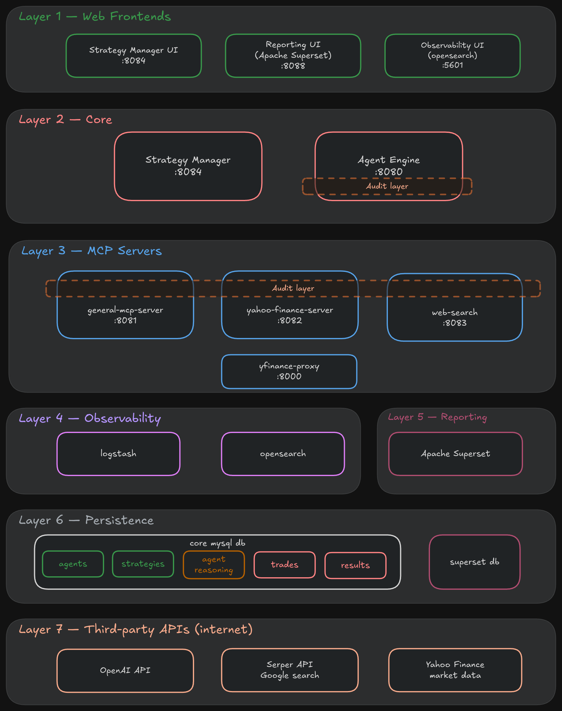

Editable source: [docs/architecture.excalidraw](docs/architecture.excalidraw).

The platform is organized into seven layers.

1. **Web Frontends.** Three browser-facing UIs: Strategy Manager's React app, Superset's dashboards, and IDP-Engine's own demo/Swagger UI. Each talks over REST to its own backend in the Core layer.
2. **Core.** `strategy-manager` is the control plane. It owns strategy/agent definitions and triggers/polls/evaluates executions on `idp-engine` purely over REST (`/api/engine/executions`, `/api/engine/evaluate-results`). `idp-engine`'s `strategy_execution` table is the sole system of record; `strategy-manager` stores nothing about execution state itself. `idp-engine` has no local strategy/agent files. It reads them exclusively from `strategy-manager`'s `/api/strategies/model` and `/api/agents/model`, failing fast if `strategy-manager` is unreachable.
3. **MCP / IDP Servers.** `idp-engine` orchestrates MCP tool calls to the three MCP servers. `IDP-MCP-Enhancer` wraps all three identically, reading `strategy_execution_uid` from request baggage (an HTTP header propagated via OpenTelemetry, never an LLM-visible tool argument or schema field) and persisting request/response telemetry. One of these servers also proxies through `yfinance-proxy` (Python) for market data rather than calling its upstream data source directly. The same server also exposes a plain REST API alongside its MCP tool surface — `idp-engine`'s evaluation path (see [Evaluating outcomes](#evaluating-outcomes-separately)) calls this REST API directly, bypassing the MCP layer and its telemetry/baggage entirely.

   `idp-engine` also owns a small fixed set of its own in-process, non-LLM tools (`ToolRegistry`) for deterministic tool steps, distinct from the MCP tool servers above. Alongside basic quote/news lookups, this includes four **pre-screen** tools — `screenValuationDisparity`, `screenMarginCompression`, `screenCashRunway`, and `screenEarningsSurpriseDrift` — each of which concurrently scans a fixed stock watchlist for a specific quantitative pattern and hands the matches to a later agent step as pre-filtered candidates, so a strategy's one expensive LLM call reviews a handful of flagged symbols instead of reasoning over the whole watchlist itself.
4. **Persistence.** MySQL is the shared datastore for application data (`strategy-manager`) and cross-service telemetry (every service via IDP-MCP-Enhancer). Superset has its own separate metadata store (`superset-db`, `superset-redis`).
5. **Observability.** Every service ships logs to Logstash, then OpenSearch, then OpenSearch Dashboards.
6. **Reporting.** Superset's dashboards are provisioned automatically on every `docker compose up` (the one-shot `superset-dashboards` service runs `build_dashboard.py` against the shared MySQL database once Superset is healthy). `strategy-manager`'s Reporting tab embeds the "Strategy Execution Drilldown" dashboard directly via Superset's guest-token/embedded-SDK flow, with a fallback deep link for when embedding isn't available.
7. **Third-party APIs.** The only external network calls: `idp-engine` to OpenAI for chat completions, `web-search` to Serper for Google search results, `yfinance-proxy` to Yahoo Finance for market data. `OPENAI_API_KEY` and `SERPER_API_KEY` are the only two runtime secrets a deployer supplies. See [Security](#security).

## Strategy execution model

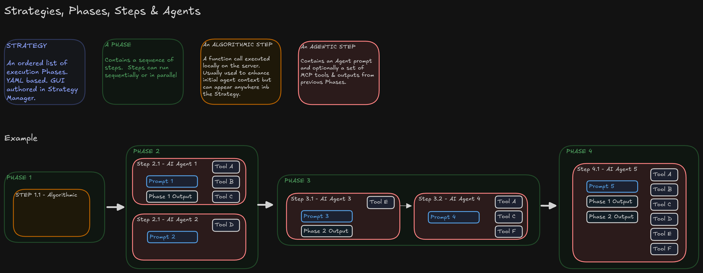

Editable source: [docs/strategy-workflow.excalidraw](docs/strategy-workflow.excalidraw).

Strategies are modeled as an ordered sequence of phases, each containing one
or more steps executed sequentially or concurrently. Each step is either a
deterministic tool invocation or an LLM-driven agent call operating within a
constrained tool allowlist, a clean separation between algorithmic and
agentic execution within a single declarative workflow.

### Strategy definitions

These types are shared between IDP-Engine and Strategy Manager via a common library, so both sides work against one authoritative shape rather than hand-synced copies.

**Strategy**
- Name, description
- A system prompt shared by every agent step in the strategy
- An ordered list of phases
- Source (where it was loaded from; informational only)

**Phase** (belongs to exactly one strategy)
- Name
- Whether its steps run in parallel or sequentially
- An ordered list of steps
- Optional layout position, for the authoring UI only; ignored at execution time

**Step** (belongs to exactly one phase)
- Either an agent reference or a tool reference, never both
- For a tool step: a parameter map, which may reference an earlier step's output within the same phase
- For an agent step: a list of earlier phase names whose output becomes this step's context

A step's context can only ever name a phase earlier than its own. An agent step can never see output from a step in its own phase, and never from a later one. This also makes circular context impossible by construction.

**Agent** (referenced by id from steps)
- Id, description
- Model override (optional; falls back to a platform default)
- A list of MCP tool names it's allowed to call
- A tool-call round budget and a timeout
- Its own system prompt

## Sequence / runtime view

How a single strategy execution actually moves through the system, from
trigger to persisted result. This complements the architecture and domain
model views, which show components and records but not the order
operations happen in.

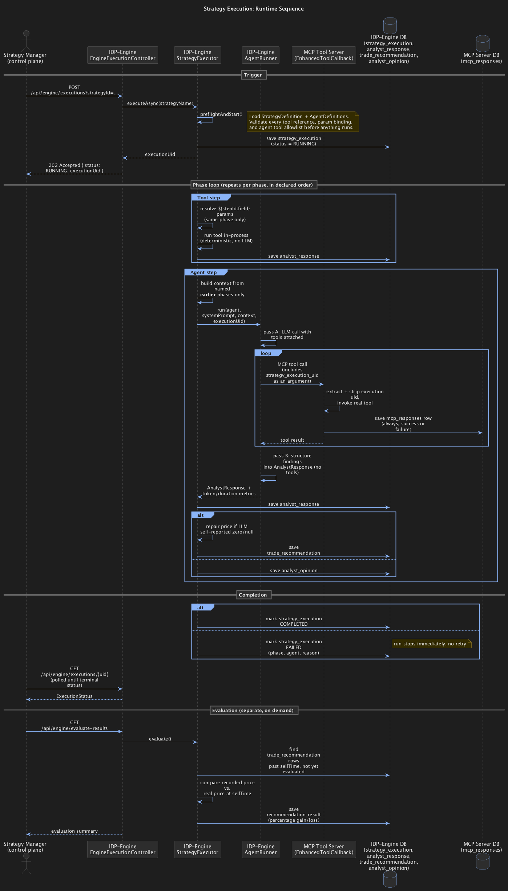

Editable source: [docs/sequence-runtime-view.puml](docs/sequence-runtime-view.puml).

### Triggering an execution

1. Strategy Manager's frontend calls its own backend:
   `POST /api/executions?strategyName=...` (`ExecutionController.startExecution`).
2. Strategy Manager's `EngineClient` relays this to IDP-Engine:
   `POST /api/engine/executions?strategyId=...` (`EngineExecutionController.startExecution`).
3. IDP-Engine's `StrategyExecutor.preflightAndStart` runs before anything else happens:
   - Loads the `StrategyDefinition` from `StrategyCatalog` (itself fetched from Strategy Manager's `GET /api/strategies/model`).
   - Validates every tool step's tool reference and parameter bindings.
   - Resolves every agent step's `AgentDefinition` and validates its declared MCP tools actually resolve against connected MCP servers.
   - Only once all of this succeeds does it create a `DBStrategyExecution` row (status `RUNNING`) and generate the execution UID.
4. IDP-Engine returns `202 Accepted` with `{status: "RUNNING", executionUid}` immediately; the run itself continues on a virtual thread.
5. Strategy Manager stores the returned `executionUid` and polls `GET /api/engine/executions/{uid}` for status until it reaches `COMPLETED` or `FAILED`.

Validation failures at step 3 abort before any database write and before any LLM call is made. There is no partial, half-started execution state.

### Running the phases

`StrategyExecutor.runPhases` iterates a strategy's phases in the order declared. Each phase's steps run either sequentially or, if the phase is marked parallel, concurrently (one virtual thread per step). Two kinds of step exist, and they execute through entirely different mechanisms.

**A tool step** is deterministic, with no LLM involved:

1. Any `${stepId.field}` parameter references to an earlier step's output in the same phase are resolved.
2. The named tool runs in-process via IDP-Engine's own tool registry (for example, fetching a stock quote).
3. The result is persisted as an `analyst_response` row and, if the step is in the strategy's final phase, may additionally produce a trade recommendation.

**An agent step** is LLM-driven and tool-augmented:

1. Context is assembled from the named *earlier* phases only (an agent step can never see output from its own phase, by design, enforced at strategy-definition validation time).
2. The agent's declared tools are resolved against live MCP servers.
3. A first LLM pass runs with those tools attached. The model can call tools across multiple rounds, up to the agent's configured round budget; exceeding it aborts the run as a loop-guard failure.
4. A second LLM pass converts the free-text findings into the strategy's structured output shape, with no tools attached.
5. The result, including prompt/completion token counts and duration, is persisted as an `analyst_response` row.

### What happens on an MCP tool call

This is a separate mechanism from the in-process tool steps above, and worth keeping distinct: this path only applies to MCP tools an *agent* calls during its tool-augmented pass.

1. IDP-Engine's agent runner opens the current execution's UID as Micrometer Tracing **baggage** for the duration of the agent run. The LLM never sees this value: it is not a tool argument, and it is not part of any tool's schema.
2. Every outgoing MCP `tools/call` request carries that baggage as a propagated HTTP header, via Spring's OpenTelemetry integration. Reactor's automatic context propagation (`spring.reactor.context-propagation=AUTO`) is required on both the calling and receiving sides for this to actually happen — baggage itself lives in thread-local state, and without it the header silently never gets attached to the request, or never gets read back out of it.
3. The MCP tool server receiving that call (not IDP-Engine) wraps every tool it exposes in a telemetry decorator (`EnhancedToolCallback`, from `IDP-MCP-Enhancer`). That decorator reads the execution UID back out of the request baggage and persists a telemetry record either way, success or failure, with the tool name, request/response payloads, duration, and outcome.
4. This gives every MCP tool invocation across the whole run a durable, queryable trail correlated back to its originating execution, independent of and in addition to IDP-Engine's own `analyst_response` records — without ever exposing the UID to the model as something it could omit, mistype, or leak into its own reasoning.

### Persisting results

Every step, tool or agent, produces an `analyst_response` row. Whether that step's output becomes something more depends on which phase it ran in:

- **Final phase**: a structured recommendation becomes a `trade_recommendation` row, with a computed sell time and, if the model under-reported price information, a deterministic correction applied before saving.
- **Any earlier phase**: the same recommendation shape instead becomes an `analyst_opinion` row, scoped to its phase, explicitly not treated as a tradeable signal.

When every phase completes, the execution row is marked `COMPLETED`. If any step throws, the execution row is marked `FAILED` with the failing phase, agent, and reason recorded, and the whole run stops immediately. There is no retry and no partial continuation past a failure.

### Evaluating outcomes, separately

Evaluation is not part of the execution path above. It runs on request, triggered by a separate endpoint call, typically from Strategy Manager or an external scheduler, not automatically inside IDP-Engine.

1. All trade recommendations whose sell time has passed, and that have not already been evaluated, are selected.
2. For each, IDP-Engine fetches the real market price at sell time with a direct, synchronous REST call to the market-data MCP server's `/api/stock/{symbol}/history` endpoint. This is a plain service-to-service REST call via the generated `IDP-StockApiClient`, not an MCP `tools/call` — it bypasses the MCP tool surface entirely, so unlike every MCP interaction an agent makes, it carries no execution-uid baggage header and produces no `mcp_responses` telemetry row. The fetched price is compared against the price recorded when the recommendation was made, producing a percentage gain or loss.
3. The result is persisted as its own record, linked back to the originating recommendation. Lookup failures (including the REST call itself failing) are still recorded, with a zero result, so the failure stays visible rather than silently disappearing, and are cleaned up by a separate maintenance pass.

A single execution leaves a connected, queryable trail across four kinds of record: one execution row, one or more analyst-response rows (one per step run), zero or more recommendation or opinion rows depending on phase, and an independent set of MCP tool telemetry rows correlated by the same execution identifier. Evaluation, when it runs, adds one more record per matured recommendation.

## Installation

### Via Claude Code

```
claude https://github.com/howardco/IDP-Platform
```

Claude Code will clone the repository and its sibling projects, configure
the environment, and bring the stack up on request.

### Manual setup

**Prerequisites**: Docker and Docker Compose.

The sibling repositories must be checked out alongside this one. The
Compose configuration references each by relative path:

```
IDP/
├── IDP-Platform/                  (this repository)
├── IDP-Engine/
├── IDP-GeneralMCPServer/
├── IDP-YahooFinanceInfoServer/
├── IDP-WebSearch/
├── IDP-yFinance-Proxy/
├── IDP-StrategyManager/
├── IDP-Strategy-Model/
├── IDP-MCP-Enhancer/
├── IDP-StockApiClient/
├── IDP-Tools/
└── IDP-Centralised-Logging/
```

Clone each repository:

```bash
mkdir -p ~/CODE/IDP && cd ~/CODE/IDP
for repo in IDP-Platform IDP-Engine IDP-GeneralMCPServer IDP-YahooFinanceInfoServer \
            IDP-WebSearch IDP-yFinance-Proxy IDP-StrategyManager IDP-Strategy-Model \
            IDP-MCP-Enhancer IDP-StockApiClient IDP-Tools IDP-Centralised-Logging; do
  git clone "https://github.com/howardco/${repo}.git"
done
```

Configure the two required secrets:

```bash
cd IDP-Platform
cp .env.example .env
```

Set `OPENAI_API_KEY` (LLM calls for chat and strategy execution) and
`SERPER_API_KEY` (the web-search tool) in `.env`. All other configuration,
including database credentials, internal service URLs, and Superset's
secret key, ships with working defaults in `docker-compose.yml`. These run
entirely within an isolated Docker network and are not externally
reachable.

Build and start the stack:

```bash
./build.sh          # builds the shared internal library image, then every service
docker compose up -d
docker compose ps   # wait for every service to report healthy
```

### Verification

Every Spring Boot service exposes a `/actuator/health` endpoint.
`idp-engine` and `strategy-manager` publish a host port and are reachable
directly; the three MCP servers do not publish a host port and are only
reachable from inside the Docker network, so their health is checked via
`docker compose exec` instead.

| Check | How |
|---|---|
| IDP-Engine health | `curl http://localhost:8090/actuator/health` |
| Strategy Manager health | `curl http://localhost:8084/actuator/health` |
| general-mcp-server health | `docker compose exec general-mcp-server curl -f http://localhost:8081/actuator/health` |
| yahoo-finance-server health | `docker compose exec yahoo-finance-server curl -f http://localhost:8082/actuator/health` |
| web-search health | `docker compose exec web-search curl -f http://localhost:8083/actuator/health` |
| IDP-Engine chat demo | `http://localhost:8090/test.html` |
| Strategy Manager UI | `http://localhost:8084` |
| Superset | `http://localhost:8088` |
| OpenSearch Dashboards | `http://localhost:5601` |

`docker compose ps` also reports each service's healthcheck status
directly, since every service above has one wired into
`docker-compose.yml`.

A successful completion via the chat demo confirms `OPENAI_API_KEY` is
valid; executing a strategy with a web-search step confirms
`SERPER_API_KEY` is valid.

## Usage

Strategy Manager (`http://localhost:8084`) is the day-to-day UI: author
strategies and agents, trigger and monitor executions, and jump into
Superset for reporting. Click any thumbnail below to view it full size.

<table>
<tr>
<td align="center" width="25%">

[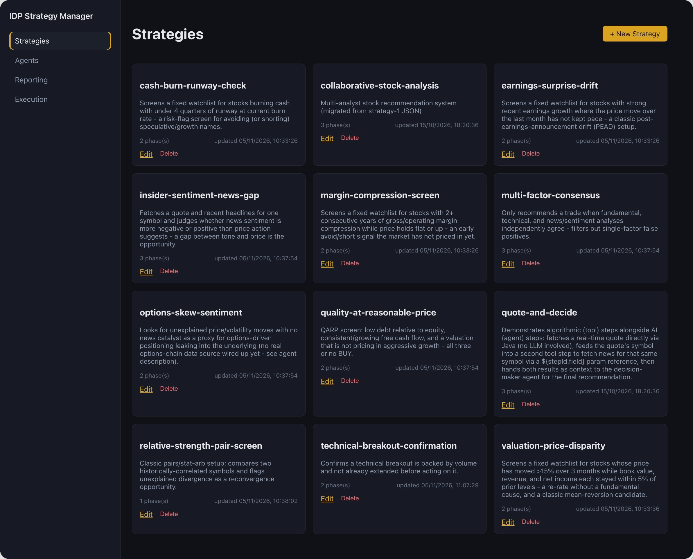](docs/IDP-Strategies.png)<br>
**Strategies**<br>
Catalog of all defined strategies, each a card showing its description and phase count.

</td>
<td align="center" width="25%">

[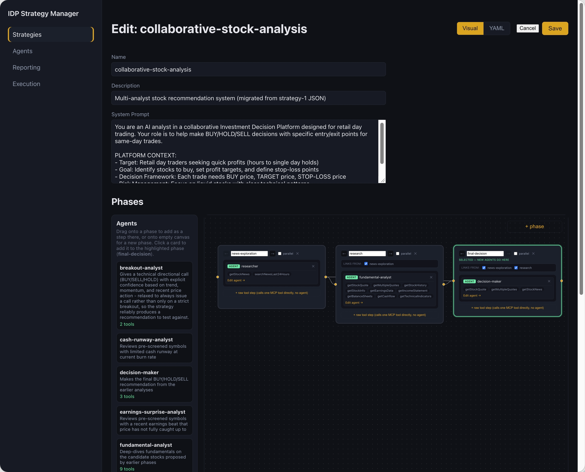](docs/IDP-Strategies-EDIT.png)<br>
**Strategy editor**<br>
Visual phase/step canvas — drag agents or raw tool steps onto a phase and wire up context links.

</td>
<td align="center" width="25%">

[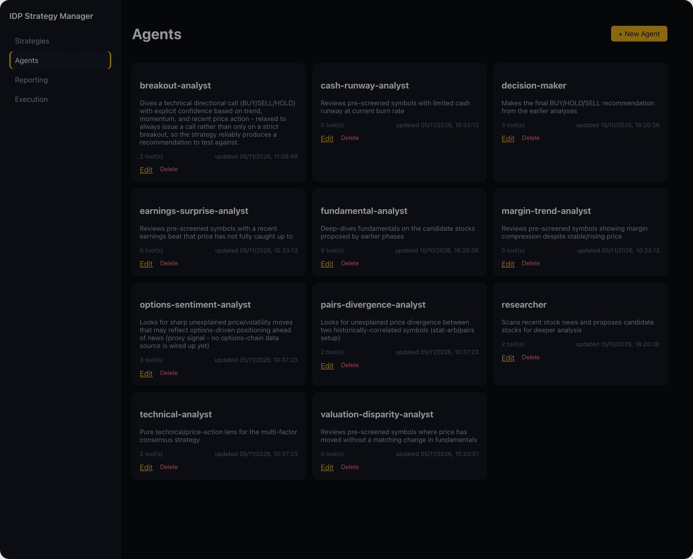](docs/IDP-Agents.png)<br>
**Agents**<br>
Catalog of reusable analyst agents, each with its tool allowlist and description.

</td>
<td align="center" width="25%">

[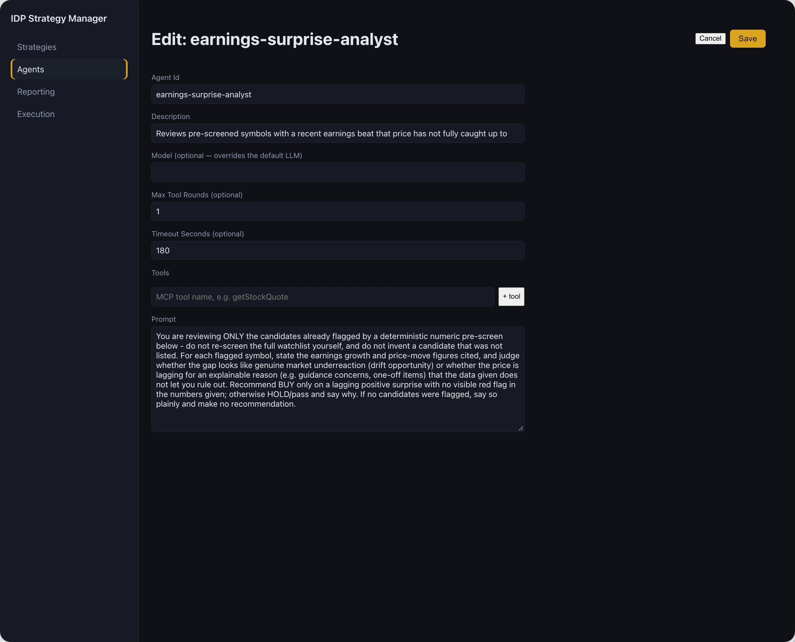](docs/IDP-Agents-EDIT.png)<br>
**Agent editor**<br>
Prompt, model override, tool-call round budget, timeout, and MCP tool allowlist for one agent.

</td>
</tr>
<tr>
<td align="center" width="25%">

[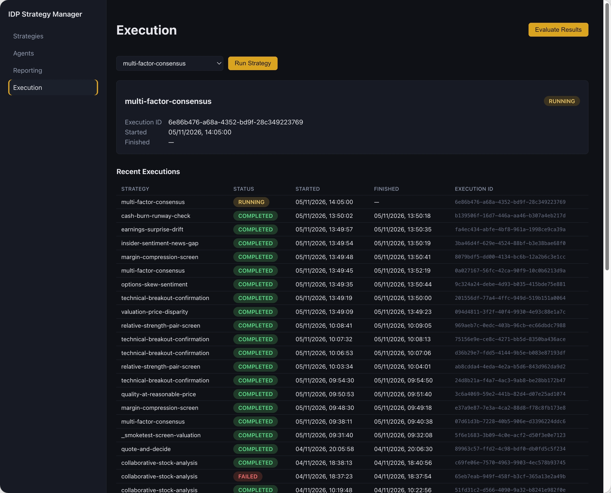](docs/IDP-Execution.png)<br>
**Execution**<br>
Trigger a strategy run, watch its live status, and browse recent execution history.

</td>
<td align="center" width="25%">

[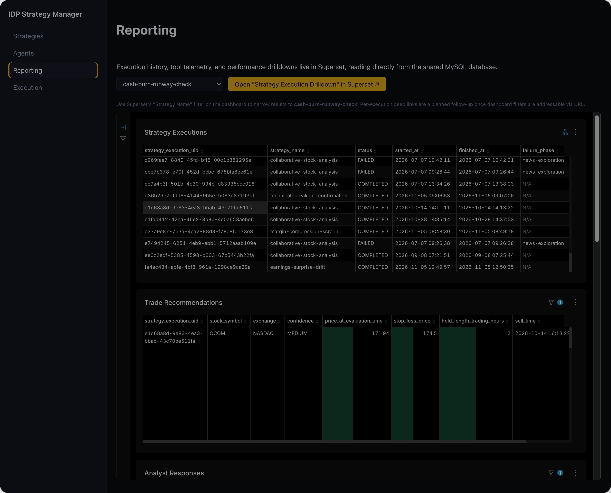](docs/IDP-Reporting-1.png)<br>
**Reporting — executions & recommendations**<br>
Embedded Superset dashboard: strategy executions and the trade recommendations they produced.

</td>
<td align="center" width="25%">

[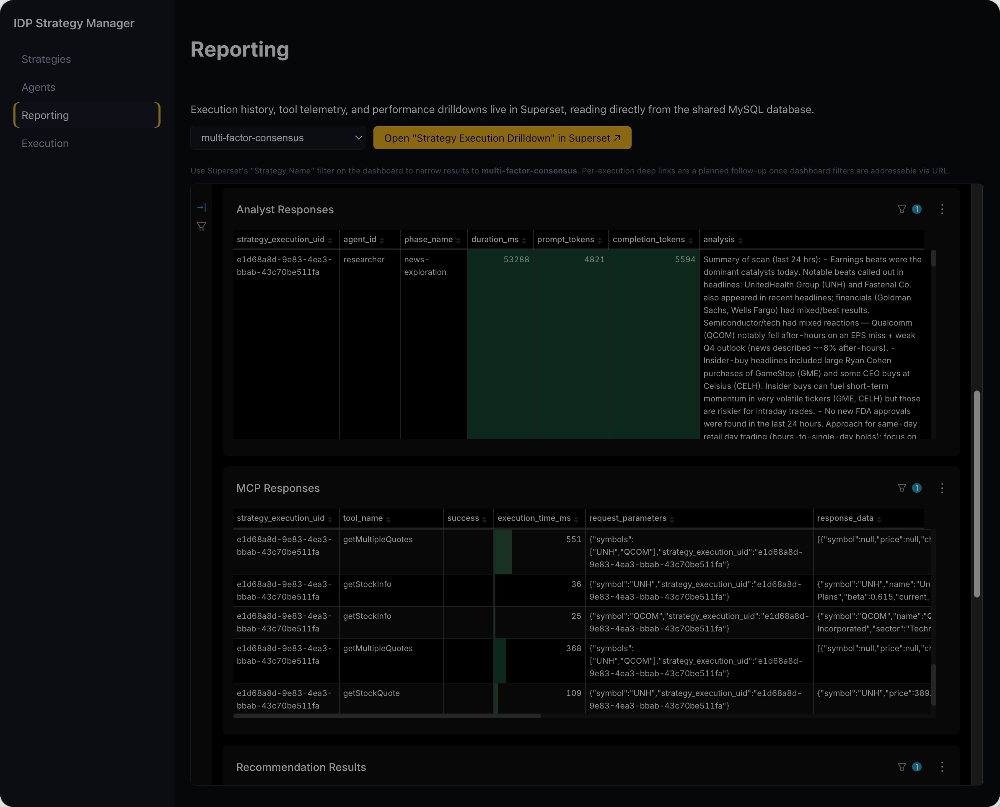](docs/IDP-Reporting-2.png)<br>
**Reporting — analyst & MCP telemetry**<br>
Per-step analyst responses alongside correlated MCP tool-call telemetry for the same execution.

</td>
<td align="center" width="25%">

[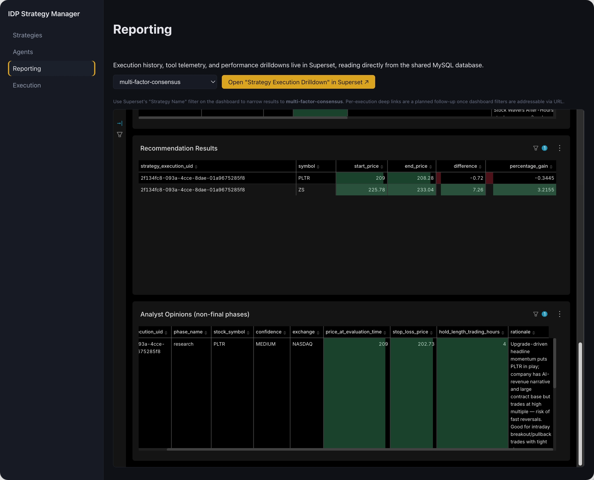](docs/IDP-Reporting-3.png)<br>
**Reporting — outcomes & opinions**<br>
Matured recommendation outcomes (start/end price, % gain) and earlier-phase analyst opinions.

</td>
</tr>
</table>

## Domain model

The core entities behind strategy definitions, execution, and reporting, and how they relate. The strategy, phase, step, and agent definitions are covered above, under [Strategy execution model](#strategy-execution-model); this section covers what gets persisted once a strategy actually runs.

### Execution records

Where strategy *definitions* are shared, execution records are owned entirely by IDP-Engine. Strategy Manager never writes to or reads from these tables directly; it only ever asks IDP-Engine over its REST API.

**Execution**: one row per triggered run
- A unique execution identifier
- The strategy name and a snapshot of the resolved strategy and agent definitions as of trigger time
- Status: running, completed, or failed
- On failure: which phase, which agent, and why
- Started and finished timestamps

**Step Response**: one row per step actually run
- Linked to its execution
- Which phase and which agent or tool produced it
- The analysis text and any structured result data
- For agent steps only: prompt/completion token counts and duration

A single execution produces many step-response rows, one per step run. The same step can produce more than one row if it's re-run within an execution.

**Recommendation**: a step response's output, when it's from the strategy's *final* phase
- The stock symbol, a confidence level, and rationale
- Price at evaluation time, a stop-loss price, and intended hold length
- A computed sell time

**Opinion**: the same shape of output, when it's from any *earlier* phase
- Everything a recommendation has, minus the sell time, plus the phase it came from
- Explicitly not a tradeable signal; it exists to make an analyst's reasoning inspectable even when it isn't the final call

A step response produces zero or more recommendations, or zero or more opinions, depending on whether its phase is the strategy's last one. It never produces both.

### MCP tool telemetry

Separate from the execution records above, and owned by the MCP tool servers rather than IDP-Engine. Every MCP tool call made during an agent step, by any tool server in the platform, is recorded independently.

**Tool Call Record**
- The execution identifier it belongs to (passed through from the calling agent, correlated loosely rather than via a database-level relationship, since it lives in a different service's datastore)
- The tool name, the request and response payloads, duration, and whether it succeeded
- An error message, if it failed

This gives every individual tool invocation across a run its own audit trail, independent of and complementary to the step-response record the invoking agent step itself produces.

### Evaluation results

Produced separately from execution, on demand, once a recommendation's sell time has passed.

**Evaluation Result**: at most one per recommendation
- The recommendation it evaluates
- Start price (recorded at the time the recommendation was made) and end price (the real market price at sell time)
- The absolute and percentage difference between them
- The stock symbol, for convenience
- When it was computed

### How it fits together

A strategy definition is authored once and can be executed many times. Each execution produces its own independent trail: one execution record, one step-response record per step run, zero or more recommendation or opinion records depending on which phase produced them, and an independently-owned set of tool-call records for every MCP call made along the way. Recommendations that mature past their sell time can later be evaluated, producing one evaluation result each. Nothing here is mutated in place. Every stage appends a new record rather than overwriting a prior one, so a strategy's full history, and every execution's full reasoning trail, remains fully reconstructible.

## Services

| Service | Host port | Role |
|---|---|---|
| `mysql` | internal | Shared datastore for application state and cross-service telemetry |
| `general-mcp-server` | internal | MCP tool server for contextual/location data |
| `yahoo-finance-server` | internal | MCP tool server for quotes, history, financials |
| `yfinance-proxy` | internal | Python service backing the Yahoo Finance tool server |
| `web-search` | internal | MCP tool server for web search |
| `idp-engine` | `8090` | Orchestration engine: strategy execution, MCP tool dispatch, chat interface |
| `strategy-manager` | `8084` | Control plane: strategy and agent authoring, execution triggering and monitoring |
| `opensearch` | internal | Log storage and search |
| `logstash` | internal | Log ingestion |
| `opensearch-dashboards` | `5601` | Log visualization |
| `superset` | `8088` | BI dashboards over the shared application data |
| `superset-db` / `superset-redis` | internal | Superset's metadata store and cache |
| `superset-dashboards` | one-shot, no port | Provisions Superset's dashboards and embedded-dashboard config (`build_dashboard.py`), then exits |

`IDP-Website` and `IDP-Frontend` are independent repositories within the
broader program and are not part of this deployment.

## Security

`OPENAI_API_KEY` and `SERPER_API_KEY` are the only secrets supplied by a
deployer, loaded from a gitignored `.env` file. Every other credential used
by the stack is a fixed internal value, scoped to a Docker network with no
external exposure.

The full program has been audited end-to-end for secret exposure. Complete
git history (`--all`), across all 14 repositories in the IDP program, was
scanned with two independent tools plus a manual pattern sweep:
[`gitleaks`](https://github.com/gitleaks/gitleaks) for rule-based
secret detection across the complete commit history of every branch, and
[`trufflehog`](https://github.com/trufflesecurity/trufflehog) for
credential verification, confirming whether any detected pattern
corresponds to a live, active key, plus a manual grep sweep targeting
patterns outside standard detector rulesets.

**All 14 repositories are confirmed clean.** No live or real-world secrets
are present in tracked history on any branch. A small number of scanner
matches were reviewed individually and confirmed to be non-issues:
truncated example values in documentation, vendored upstream boilerplate
with generic dev defaults, and non-sensitive configuration strings. None
required action.

Runtime configuration across every service follows a single pattern:
externally supplied values are read from environment variables
(`${VAR_NAME}`), never hardcoded. This audit protocol runs against new
repositories as they're added to the program, and is re-run on request.

## License

Released under the [MIT License](LICENSE). The software is provided "as
is," without warranty of any kind; use it at your own risk.
