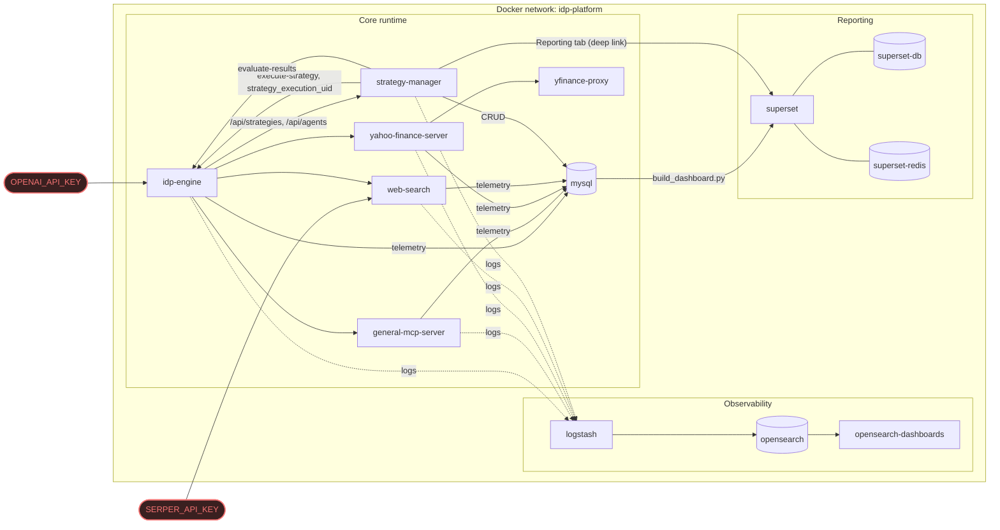

# Architecture

## Key paths

- **Strategy authoring & execution control**: `strategy-manager` is the control plane — it owns strategy/agent definitions and triggers/polls/evaluates executions on `idp-engine` purely over REST (`/api/engine/executions`, `/api/engine/evaluate-results`). `idp-engine`'s `strategy_execution` table is the sole system of record; `strategy-manager` stores nothing about execution state itself.
- **Strategy/agent source of truth**: `idp-engine` has no local strategy/agent files — it reads them exclusively from `strategy-manager`'s `/api/strategies/model` and `/api/agents/model`, failing fast if `strategy-manager` is unreachable.
- **Tool calls**: `idp-engine` orchestrates calls out to the three MCP servers (`general-mcp-server`, `yahoo-finance-server`, `web-search`); `yahoo-finance-server` itself proxies to `yfinance-proxy` (Python/yfinance) for the underlying market data.
- **Secrets**: exactly two runtime secrets cross the network boundary — `OPENAI_API_KEY` into `idp-engine`, `SERPER_API_KEY` into `web-search`. Everything else (DB credentials, Superset's own secret key) is internal-only.
- **Telemetry**: every service writes `strategy_execution_uid`-correlated rows to MySQL (via IDP-MCP-Enhancer for the MCP servers), which Superset's dashboards read directly.
- **Logging**: every service ships logs to Logstash → OpenSearch → OpenSearch Dashboards.
- **Reporting**: Superset's dashboards are built once (`build_dashboard.py`) against the shared MySQL database; `strategy-manager`'s Reporting tab deep-links out to Superset rather than embedding it.
